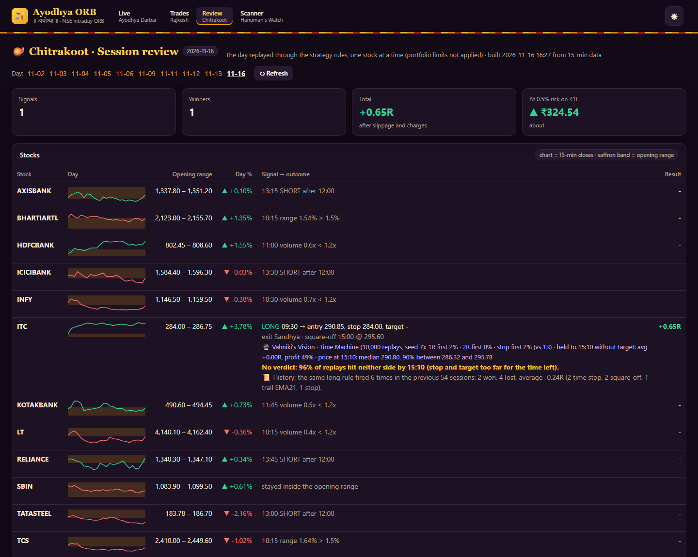
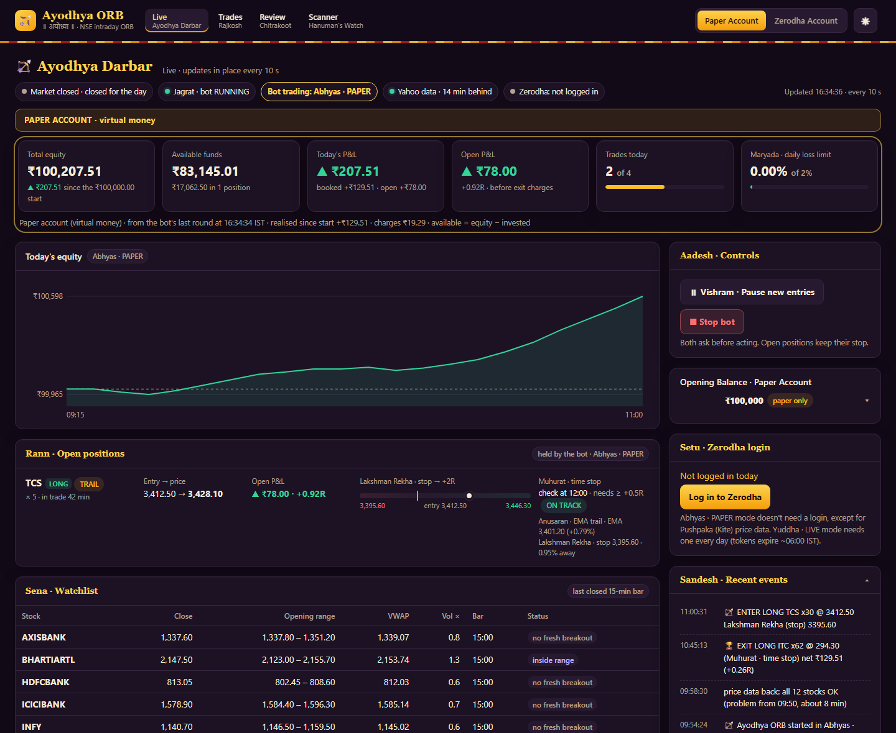
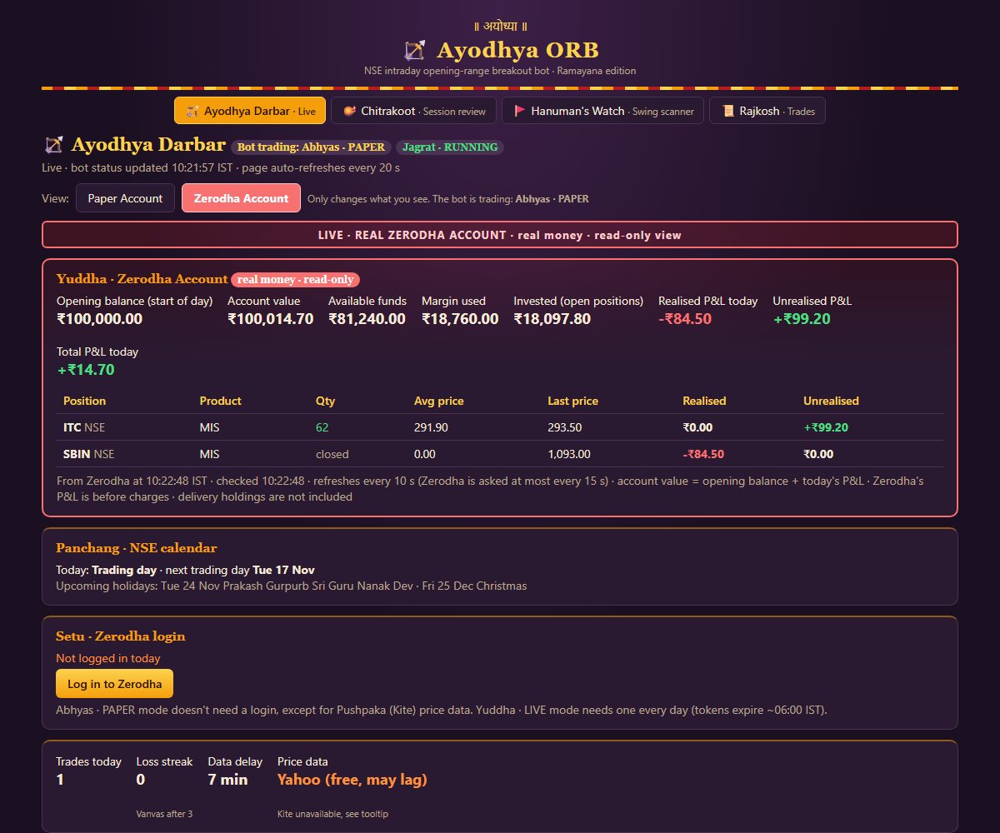
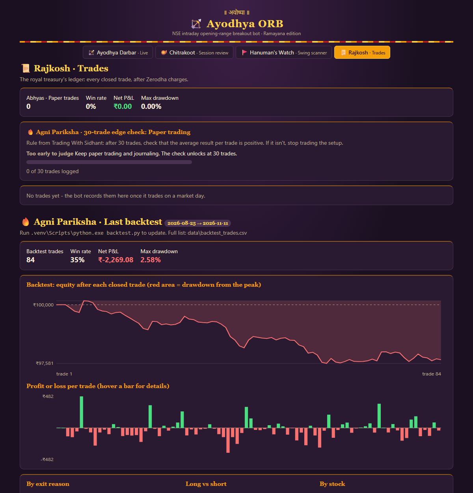
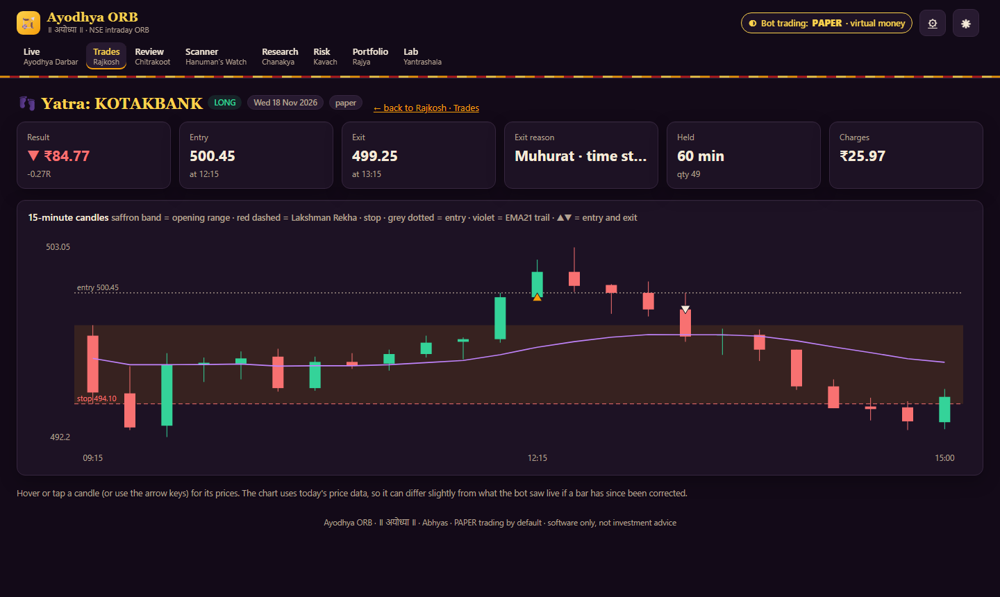
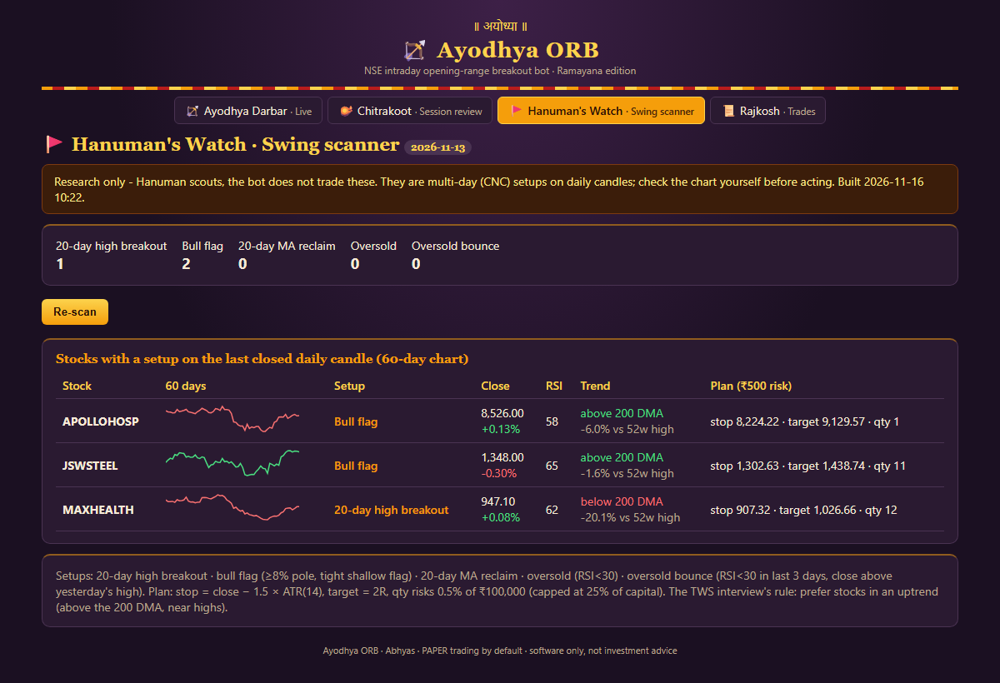
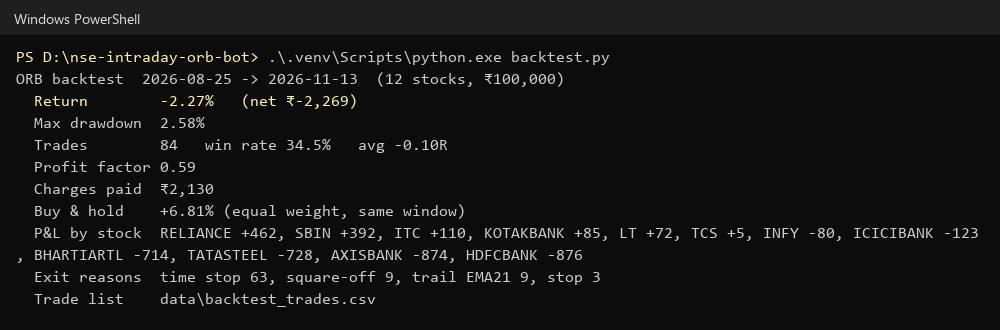

# 🏹 Ayodhya ORB: NSE Intraday ORB Bot (Ramayana edition)

A Windows app that **paper-trades Indian stocks (NSE)** with an *opening range breakout* strategy,
and shows everything on a simple dashboard in your browser. The app is themed on the **Ramayana**
(see [the glossary](#the-ramayana-theme)). Every themed name is shown next to the plain trading term, so nothing is hidden.

- **Paper trading by default**: pretend money (₹1,00,000), real live prices. No Zerodha account, API key or payment needed.
- Watches 12 big, liquid stocks (RELIANCE, HDFCBANK, ICICIBANK, INFY, TCS, SBIN, AXISBANK, KOTAKBANK, LT, ITC, BHARTIARTL, TATASTEEL).
- Free price data from Yahoo Finance. Knows NSE market hours and holidays.
- Dashboard pages: **Ayodhya Darbar · Live**, **Chitrakoot · Session review** (with a 10,000-replay *Time Machine*, "Valmiki's Vision"), **Hanuman's Watch · Swing scanner**, **Rajkosh · Trades**.
- Can trade real money through Zerodha Kite Connect, but only if you deliberately switch it on ([advanced guide](docs/LIVE-TRADING.md)).

> ⚠️ **Please read**
> - **This strategy has lost money in testing** (−2.3% over 60 days, while just holding the same stocks made +6.8%). It is a learning project, not a money machine.
> - Most people who day trade lose money. Use paper trading for weeks before even thinking about real money.
> - Free data can be a few minutes late. Education only, not financial advice. The authors are not SEBI-registered.



---

## Quick start (Windows, about 10 minutes)

You need: a Windows 10 or 11 PC and an internet connection. Nothing else.

### Step 1: Install Python (one time)

1. Open **https://www.python.org/downloads/** and click the big yellow **Download Python** button.
2. Open the downloaded file.
3. ⚠️ On the first screen, **tick the box "Add python.exe to PATH"** at the bottom. This is the step people miss.
4. Click **Install Now** and wait until it says *Setup was successful*. Close it.

Already have Python 3.12 or newer? Skip this step.

### Step 2: Download this project

1. On this GitHub page, click the green **`<> Code`** button, then **Download ZIP**.
   (Or download a fixed version from the **Releases** page; see [CHANGELOG.md](CHANGELOG.md).)
2. Find the ZIP in your *Downloads* folder, right-click it, choose **Extract All…**, then **Extract**.
3. Open the extracted folder. You should see files named `1-SETUP.bat`, `2-START-BOT.bat`, `3-DASHBOARD.bat`…

Tip: move the folder somewhere simple first, like `D:\orb-bot`, and avoid OneDrive folders.

### Step 3: Run the setup (one time)

1. **Double-click `1-SETUP.bat`.**
2. If Windows shows *"Windows protected your PC"*, click **More info**, then **Run anyway**. This appears because the file came from the internet.
3. A black window opens and installs everything (1–3 minutes). Wait for **`=== Setup complete ===`**:


Press any key to close the window.

### Step 4: Open the dashboard (any day, any time)

**Double-click `3-DASHBOARD.bat`.** Your browser opens **http://127.0.0.1:5000**.
This only *shows* information and never trades, so it's safe to run on weekends.
Keep the black window open while you use the dashboard; close it when you're done.



### Step 5: Paper-trade on a market day

On a weekday (not an NSE holiday), **before 9:15 AM IST**:

1. **Double-click `2-START-BOT.bat`.** The dashboard opens and the bot starts in **PAPER** mode.
2. Leave the black window open and the PC awake. Look at the dashboard whenever you like:
   it refreshes every 20 seconds.
3. The bot takes trades from about 9:45 AM, closes everything by **3:10 PM**, and **stops by itself at 3:35 PM**.

To stop early, click **Stop bot** on the dashboard, or just close the black window.

### Step 6 (optional): Start automatically every weekday

**Double-click `4-SCHEDULE.bat`.** Windows will start the bot at 9:00 AM Monday to Friday.
Your PC must be **on, logged in and not sleeping** during market hours (set *Sleep* to *Never* in Windows power settings).
To undo it, double-click `5-UNSCHEDULE.bat`.

---

## What the dashboard pages show

| Page | What you see |
|---|---|
| 🏹 **Ayodhya Darbar · Live** | Is the bot running? The **account card** (see below), open positions (profit in ₹ and R, how far the stop is, where the EMA trail is, when the 1-hour time stop is checked, time in trade), every stock's opening range and why it is or isn't a trade, recent events, NSE holiday calendar, Pause/Stop buttons |
| 🪔 **Chitrakoot · Session review** | Pick any recent trading day. For each stock: a mini chart, whether the rules fired, and how the trade would have ended. Each trade also shows the **Time Machine**: the odds from 10,000 replays of that stock's own moves, a plain verdict ("coin flip", "leans toward the stop"…) and the rule's real track record over 60 days |
| 🚩 **Hanuman's Watch · Swing scanner** | Nifty 50 stocks with a multi-day setup on the last daily candle (20-day breakout, bull flag, 20-day average reclaim, oversold, oversold bounce), with a suggested stop, target and quantity. **Research only: the bot doesn't trade these** |
| 📜 **Rajkosh · Trades** | An **equity curve** (with drawdowns shaded), a **profit/loss bar per trade**, breakdowns **by exit reason, long vs short and stock**, every trade with a **chart** link (the day's candles with entry, exit, stop and trail drawn on), the last backtest shown the same way, and the **30-trade edge check**: after 30 trades it tells you whether the average result per trade is positive, and to stop if it isn't |

### Paper opening balance

The paper account starts at ₹1,00,000 unless you choose another amount. On the Live page (Paper Account
view), the **Opening Balance · Paper Account** card offers ₹10,000, ₹25,000, ₹50,000, ₹1,00,000, ₹5,00,000 or
a custom amount (whole rupees, ₹10,000 to ₹1 crore). After you confirm:

- The choice is saved as **pending** in `data\paper_capital.json`. The bot applies it at its **next start**
  (normally 9:00), before any trade, and waits if paper positions are still open. You can cancel it until then.
- Cash moves by the difference, so equity = new opening balance + realised P&L + open P&L. Past trades,
  realised P&L and charges stay exactly as recorded, and each change is listed on the account card.
- Trade sizes follow the new equity (0.5% risk per trade). Below ₹50,000, trades are small and stocks priced
  above 25% of the balance are skipped.
- **Paper only:** live trading and your Zerodha account never read this setting. The backtest and the
  advisor report stay at ₹1,00,000 so their results remain comparable.

### Paper Account | Zerodha Account

The Live and Trades pages have a **View: Paper Account | Zerodha Account** switch. It only changes what you
see: the bot keeps trading in its own mode (the header always says "Bot trading: Abhyas · PAPER"), and
switching never changes a setting or places an order.

- **Paper Account** (gold frame, "virtual money"): starting balance, total equity, available funds,
  invested amount, realised P&L (since the start and today), unrealised P&L, total P&L and charges, from
  `data\state_paper.json` only. The Trades page shows only paper trades.
- **Zerodha Account** (red frame, "real money · read-only"): your real opening balance, account value,
  available funds, margin used, invested amount, today's realised/unrealised/total P&L and each position.
  It needs the day's Zerodha login and reads only Kite's balance and positions; it can't place, change or
  cancel an order. Balances are kept in memory for 15 seconds and never saved. The Trades page shows only
  the trades the bot placed in live mode.
- The card refreshes every 10 seconds, shows when it was last updated, and warns about stale data, slow
  prices, login problems and failed refreshes (it keeps the last good values and says when they're from).



*The Zerodha Account view, with example figures (not a real account).*

### Daily journal, weekly and monthly reports

Everything is saved as plain files in the project's `data` folder, separately for paper and live trading:

| File | What's in it |
|---|---|
| `data\trades_paper.csv` | Every closed trade (the record of truth) |
| `data\journal\journal_paper.csv` | **One row per trading day**: starting and ending equity, net P&L and %, charges, trades, wins, total R, best/worst trade, the day's **worst drawdown** (checked every round), signals taken and skipped with the reasons, data outages, when the bot ran, and whether the day is **complete** |
| `data\journal\paper\2026-11-16.json` | That day in detail: every signal and what happened to it, each outage, every bot start, equity every minute |
| `data\reports\paper_week_2026-W47.html`, `paper_month_2026-11.html` | Saved **weekly and monthly reports**: summary, equity at each close, day-by-day table, trades, skip reasons. Open in a browser, print or save as PDF |
| `data\logs\bot_2026-11-16.log` | **One log file per day** |

- The bot updates the day's journal **every round**, so a crash keeps everything up to that moment. After the
  close the day is marked **complete**; a STOP file marks it **stopped HH:MM**; a day the bot didn't finish
  shows as **incomplete**. Days with trades but no journal are **rebuilt** from the trade log (signals and
  drawdown are then unknown, shown as –).
- The **Trades page** has a **Daily | Weekly | Monthly** card with a **Download CSV** button and links to
  the saved reports. It follows the Paper Account | Zerodha Account view.
- Weekly and monthly reports are written after the close on the last trading day of the week or month (or at
  the next start if the bot missed the close). Any time: `.venv\Scripts\python.exe reports.py --week 2026-W47`
  or `--month 2026-11`.
- **Daily backup:** after the close the whole `data` folder is zipped to
  `KiteConnect\backups\data\data_2026-11-16.zip`, keeping the newest 30. That folder is on the same disk; to
  survive a disk failure point it at OneDrive or a USB drive:
  `[Environment]::SetEnvironmentVariable("BACKUP_DIR", "D:\OneDrive\kite-backups", "User")`.
  Back up by hand with `.venv\Scripts\python.exe backup.py`.
- The journal, reports and backups only **record**: the strategy and risk rules never read them, and a problem
  writing them is a warning in the log, never a reason to stop trading.

| Trades: equity curve and P&L bars | Trade chart |
|---|---|
|  |  |



## The Ramayana theme

The dashboard, console windows and log messages use names from the Ramayana. The plain trading term is
always shown next to the themed name (for example **Lakshman Rekha · stop**), and the trade files
(`data\*.csv`) keep the plain words, so spreadsheets and analysis don't change.

| Themed name | Plain meaning | Why this name |
|---|---|---|
| **Ayodhya ORB** | the bot | Rama's kingdom: home |
| **Ayodhya Darbar** | Live page | the royal court, where today's business happens |
| **Chitrakoot** | Session review | where Rama and Bharata met to reflect |
| **Hanuman's Watch** | Swing scanner | Hanuman scouted Lanka before the battle |
| **Rajkosh** | Trades | the royal treasury's ledger |
| **Yatra** | one trade's chart | the journey of a trade |
| **Valmiki's Vision** | Time Machine | the sage who saw the whole story |
| **Agni Pariksha** | backtest / 30-trade edge check | the trial by fire |
| **Lakshman Rekha** | stop-loss | the line that must not be crossed |
| **Lakshya** | target | the aim |
| **Anusaran** | 21 EMA trailing exit | "following" the price |
| **Muhurat** | 1-hour time stop | the trade's window has passed |
| **Sandhya** | 15:10 square-off | dusk: everything is closed |
| **Maryada** | 2% daily loss limit | Rama's self-imposed limits |
| **Vanvas** | 2-day cool-down after 3 losses | exile from the market |
| **Vanar Sena** | index filter | trade with the army (the sector index), not against it |
| **Pushpaka** | Kite real-time data | the swift flying chariot |
| **Setu** | Zerodha login | the bridge to the exchange |
| **Abhyas / Yuddha** | PAPER / LIVE mode | practice / battle |
| **Vishram** | pause | rest |
| **Sandesh** | recent events | messages |
| **Panchang** | NSE calendar | the almanac |
| **Utsav** | market holiday | festival |
| **Aadesh** | controls | commands |
| **Jagrat / Nidra** | running / not running | awake / asleep |
| **Guru Vashishtha** | learning advisor | Ayodhya's royal advisor: he counsels, the king decides |

All names live in one file, [`theme.py`](theme.py). Change them there to rename anything.

---

## Learning advisor: Guru Vashishtha (weekly report)

The advisor reports which rules helped and which hurt. **It never changes a setting or the bot**: it only
writes files to `data\advisor\`. Run these in PowerShell inside the project folder:

```powershell
.venv\Scripts\python.exe archive.py --status      # what the candle archive holds
.venv\Scripts\python.exe archive.py               # save every finished day the data source still has
.venv\Scripts\python.exe advisor.py report        # the weekly report (about 10 minutes for a year)
.venv\Scripts\python.exe advisor.py report --no-rules --days 120   # quicker: no rule check, last 120 days
```

- **Every trade records its conditions at entry:** signal time, range width, breakout volume, distance
  from VWAP, index change and gap. They're the last six columns of the trade files.
- **Candle archive:** after each close the bot saves the day's 15-minute candles to `data\candles\`, so
  history keeps growing. With the Kite plan, the first `archive.py` run saves about a year.
- **The report:**
  - Backtests your current settings on the archive.
  - Breaks the trades down by entry time, direction, range width, volume, weekday, stock and exit reason,
    with a 95% range for each.
  - Replays the same data with one rule switched off at a time.
  - Shows paper trades separately.

---

## Something went wrong?

| Problem | Fix |
|---|---|
| Setup says **Python is not installed** | Do Step 1 again and make sure you tick **Add python.exe to PATH**. Then restart the PC and run `1-SETUP.bat` again |
| **"Windows protected your PC"** | Click **More info**, then **Run anyway** |
| The black window opens and closes instantly | Open the project folder, click the address bar, type `powershell` and press Enter. In the blue window type `.\1-SETUP.bat` (or the file you tried) and press Enter to read the error |
| Browser shows **"This site can't be reached"** | The black window was closed. Double-click `3-DASHBOARD.bat` (or `2-START-BOT.bat`) again and keep it open |
| Live page says **NOT RUNNING** | Normal outside market hours, on weekends and on holidays. On a market day, run `2-START-BOT.bat` |
| **Data delay** shows 15+ minutes | Yahoo's free data is running late. Paper results will be less accurate that day. Kite data fixes this (see above) |
| Live page says **Kite unavailable** | Log in to Zerodha on the dashboard (needed every day), then run `6-CHECK-KITE-DATA.bat` |
| Setup says **self-tests failed** | Copy the red text and open an *Issue* on this GitHub page |
| I want to reset the paper account | Delete the `data` folder inside the project (it holds paper trades, P&L, journal, reports and logs), then start the bot again. The daily backups in `KiteConnect\backups\data` stay |
| Log says **journal CSV is open in another program** | Close `journal_paper.csv` in Excel. The day is still saved in `data\journal\paper\<date>.json` and the CSV catches up at the next round |
| I need data back from a backup | Stop the bot, rename the `data` folder, unzip the backup (it contains a `data` folder) into the project folder |

---

## Better price data: Kite Connect (optional, about ₹500/month)

Free Yahoo data can lag a few minutes and only goes back ~60 days. With Zerodha's paid **Kite Connect** plan
(**₹500/month = 500 credits for 30 days**, GST included) the bot can use Zerodha's own real-time prices and years of history.

**Full step-by-step guide with screenshots (adding credits, creating the app, switching the bot):
[docs/KITE-CONNECT-PLAN.md](docs/KITE-CONNECT-PLAN.md)**. Short version:

1. On https://developers.kite.trade, add **500 credits** under **Billing** and create a **Connect** app under **My apps**,
   then save its API key with `set_kite_keys.ps1` (see the guide).
2. Double-click **`3-DASHBOARD.bat`** and click **Log in to Zerodha** (Kite data needs a login every day).
3. Double-click **`6-CHECK-KITE-DATA.bat`**. It should say *Kite data works* and how many days of history you get.
4. In PowerShell run `[Environment]::SetEnvironmentVariable("DATA_SOURCE", "kite", "User")`, then restart the bot.

The Live page shows **Price data: Kite (real-time)**. If Kite can't be used that moment (you didn't log in
today, the plan lapsed, network trouble), the bot automatically uses Yahoo and the page says why.
With Kite you can also backtest further back: `.venv\Scripts\python.exe backtest.py --days 180`.

---

## Changing settings (optional)

All settings live in `config.py` with comments. Open it in Notepad, change a number, save, and restart the bot.
Common ones:

| Setting | Default | Meaning |
|---|---|---|
| `PAPER_START_INR` | `100000.0` | Pretend money you start with |
| `RISK_PER_TRADE_PCT` | `0.5` | Most you can lose on one trade, % of your money (charges included) |
| `MAX_OPEN_POSITIONS` | `3` | Most trades open at the same time |
| `MAX_DAILY_LOSS_PCT` | `2.0` | Stop new trades for the day once booked + open losses reach this % |
| `WATCHLIST` | 12 stocks | Which stocks the bot trades (NSE symbols) |
| `DATA_SOURCE` | `yahoo` | `kite` for real-time Zerodha data (paid Connect plan, see above) |
| `LAST_ENTRY` / `SQUARE_OFF` | `12:00` / `15:10` | No new trades after this time / close everything at this time |

Each December, add next year's NSE holidays to `nse_holidays.json` (the list is on nseindia.com).

---

## More documentation

- **[How the strategy works, and the test results](docs/STRATEGY.md)**: rules, risk limits, backtest, Time Machine, files
- **[Real-money trading with Zerodha (advanced)](docs/LIVE-TRADING.md)**: Kite Connect app, static IP, daily login, safety switches
- **[Paid Kite Connect plan for real-time data](docs/KITE-CONNECT-PLAN.md)**: 500 credits a month, adding credits, creating the app, switching the bot
- **[Versions (CHANGELOG)](CHANGELOG.md)**: what changed in each release, and how to go back to an older one

For developers: `.\.venv\Scripts\python.exe -m pytest -q` runs 91 offline tests;
`.\.venv\Scripts\python.exe backtest.py` runs the 60-day backtest.



## Disclaimer

For education only. Not investment advice or a recommendation to buy or sell any security.
Trading involves risk of loss. Past or simulated results do not guarantee future results. You are
responsible for any trades you place, and for complying with SEBI rules and your broker's terms.
