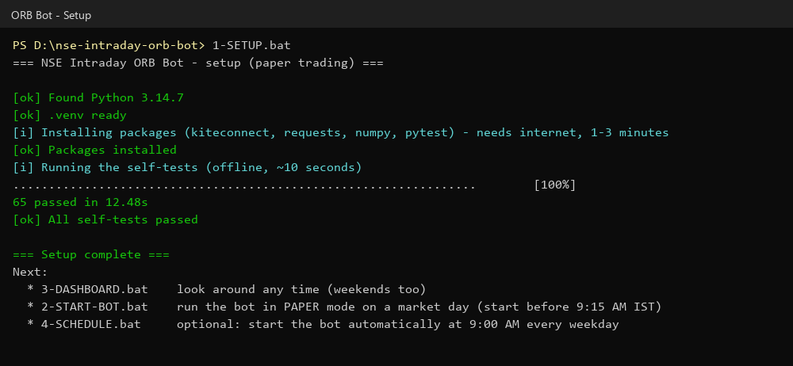

# NSE Intraday ORB Bot

A Windows app that **paper-trades Indian stocks (NSE)** with an *opening range breakout* strategy,
and shows everything on a simple dashboard in your browser.

- **Paper trading by default**: pretend money (₹1,00,000), real live prices. No Zerodha account, API key or payment needed.
- Watches 12 big, liquid stocks (RELIANCE, HDFCBANK, ICICIBANK, INFY, TCS, SBIN, AXISBANK, KOTAKBANK, LT, ITC, BHARTIARTL, TATASTEEL).
- Free price data from Yahoo Finance. Knows NSE market hours and holidays.
- Dashboard pages: **Live**, **Session review** (with a 10,000-replay *Time Machine*), **Swing scanner**, **Trades**.
- Can trade real money through Zerodha Kite Connect, but only if you deliberately switch it on ([advanced guide](docs/LIVE-TRADING.md)).

> ⚠️ **Please read**
> - **This strategy has lost money in testing** (−2.3% over 60 days, while just holding the same stocks made +6.8%). It is a learning project, not a money machine.
> - Most people who day trade lose money. Use paper trading for weeks before even thinking about real money.
> - Free data can be a few minutes late. Education only, not financial advice. The authors are not SEBI-registered.

---

## Quick start (Windows, about 10 minutes)

You need: a Windows 10 or 11 PC and an internet connection. Nothing else.

### Step 1: Install Python (one time)

1. Open **https://www.python.org/downloads/** and click the big yellow **Download Python** button.
2. Open the downloaded file.
3. ⚠️ On the first screen, **tick the box "Add python.exe to PATH"** at the bottom. This is the step people miss.
4. Click **Install Now** and wait until it says *Setup was successful*. Close it.

Already have Python 3.12 or newer? Skip this step.

### Step 2: Download this project

1. On this GitHub page, click the green **`<> Code`** button, then **Download ZIP**.
2. Find the ZIP in your *Downloads* folder, right-click it, choose **Extract All…**, then **Extract**.
3. Open the extracted folder. You should see files named `1-SETUP.bat`, `2-START-BOT.bat`, `3-DASHBOARD.bat`…

Tip: move the folder somewhere simple first, like `D:\orb-bot`, and avoid OneDrive folders.

### Step 3: Run the setup (one time)

1. **Double-click `1-SETUP.bat`.**
2. If Windows shows *"Windows protected your PC"*, click **More info**, then **Run anyway**. This appears because the file came from the internet.
3. A black window opens and installs everything (1–3 minutes). Wait for **`=== Setup complete ===`**:

Press any key to close the window.

### Step 4: Open the dashboard (any day, any time)

**Double-click `3-DASHBOARD.bat`.** Your browser opens **http://127.0.0.1:5000**.
This only *shows* information and never trades, so it's safe to run on weekends.
Keep the black window open while you use the dashboard; close it when you're done.

### Step 5: Paper-trade on a market day

On a weekday (not an NSE holiday), **before 9:15 AM IST**:

1. **Double-click `2-START-BOT.bat`.** The dashboard opens and the bot starts in **PAPER** mode.
2. Leave the black window open and the PC awake. Look at the dashboard whenever you like:
   it refreshes every 20 seconds.
3. The bot takes trades from about 9:45 AM, closes everything by **3:10 PM**, and **stops by itself at 3:35 PM**.

To stop early, click **Stop bot** on the dashboard, or just close the black window.

### Step 6 (optional): Start automatically every weekday

**Double-click `4-SCHEDULE.bat`.** Windows will start the bot at 9:00 AM Monday to Friday.
Your PC must be **on, logged in and not sleeping** during market hours (set *Sleep* to *Never* in Windows power settings).
To undo it, double-click `5-UNSCHEDULE.bat`.

---

## What the dashboard pages show

| Page | What you see |
|---|---|
| **Live** | Is the bot running? Paper equity, today's P&L, open positions, every stock's opening range and why it is or isn't a trade, recent events, NSE holiday calendar, Pause/Stop buttons |
| **Session review** | Pick any recent trading day. For each stock: a mini chart, whether the rules fired, and how the trade would have ended. Each trade also shows the **Time Machine**: the odds from 10,000 replays of that stock's own moves, a plain verdict ("coin flip", "leans toward the stop"…) and the rule's real track record over 60 days |
| **Swing scanner** | Nifty 50 stocks with a multi-day setup on the last daily candle (20-day breakout, bull flag, 20-day average reclaim, oversold, oversold bounce), with a suggested stop, target and quantity. **Research only: the bot doesn't trade these** |
| **Trades** | Every paper trade (entry, exit, charges, profit or loss), win rate, plus the last backtest result |

| Swing scanner | Trades |
|---|---|
|  |  |

---

## Something went wrong?

| Problem | Fix |
|---|---|
| Setup says **Python is not installed** | Do Step 1 again and make sure you tick **Add python.exe to PATH**. Then restart the PC and run `1-SETUP.bat` again |
| **"Windows protected your PC"** | Click **More info**, then **Run anyway** |
| The black window opens and closes instantly | Open the project folder, click the address bar, type `powershell` and press Enter. In the blue window type `.\1-SETUP.bat` (or the file you tried) and press Enter to read the error |
| Browser shows **"This site can't be reached"** | The black window was closed. Double-click `3-DASHBOARD.bat` (or `2-START-BOT.bat`) again and keep it open |
| Live page says **NOT RUNNING** | Normal outside market hours, on weekends and on holidays. On a market day, run `2-START-BOT.bat` |
| **Data delay** shows 15+ minutes | Yahoo's free data is running late. Paper results will be less accurate that day |
| Setup says **self-tests failed** | Copy the red text and open an *Issue* on this GitHub page |
| I want to reset the paper account | Delete the `data` folder inside the project (it holds paper trades, P&L and logs), then start the bot again |

---

## Changing settings (optional)

All settings live in `config.py` with comments. Open it in Notepad, change a number, save, and restart the bot.
Common ones:

| Setting | Default | Meaning |
|---|---|---|
| `PAPER_START_INR` | `100000.0` | Pretend money you start with |
| `RISK_PER_TRADE_PCT` | `0.5` | Most you can lose on one trade, % of your money (charges included) |
| `MAX_OPEN_POSITIONS` | `3` | Most trades open at the same time |
| `MAX_DAILY_LOSS_PCT` | `2.0` | Stop new trades for the day after losing this % |
| `WATCHLIST` | 12 stocks | Which stocks the bot trades (NSE symbols) |
| `LAST_ENTRY` / `SQUARE_OFF` | `12:00` / `15:10` | No new trades after this time / close everything at this time |

Each December, add next year's NSE holidays to `nse_holidays.json` (the list is on nseindia.com).

---

## More documentation

- **[How the strategy works, and the test results](docs/STRATEGY.md)**: rules, risk limits, backtest, Time Machine, files
- **[Real-money trading with Zerodha (advanced)](docs/LIVE-TRADING.md)**: Kite Connect app, static IP, daily login, safety switches

For developers: `.\.venv\Scripts\python.exe -m pytest -q` runs 65 offline tests;
`.\.venv\Scripts\python.exe backtest.py` runs the 60-day backtest.

## Disclaimer

For education only. Not investment advice or a recommendation to buy or sell any security.
Trading involves risk of loss. Past or simulated results do not guarantee future results. You are
responsible for any trades you place, and for complying with SEBI rules and your broker's terms.
