# Ayodhya ORB 2.0: step-by-step guide

[← back to README](../README.md) · [What changed in 2.0](../CHANGELOG.md) · [Readiness report](PRODUCTION-READINESS.md)

This guide walks through the 2.0 dashboard one step at a time: starting the bot, a trading day from open to
close, the eight pages, and the safety and maintenance tools.

**About the screenshots.** Every screenshot here is from a demo on **virtual money**: the paper bot replaying a
real market day on a ₹1,00,000 paper account. No real account, balance or login appears. They use the
**Swarajya** theme, where the pages are named Gad, Daftar, Bakhar and Buruj Watch; in other themes the same
pages carry other names, and the plain word (Live, Trades, Review, Scanner) is always shown next to them.

**Read this first.** The software is tested and safe to run (see the [readiness report](PRODUCTION-READINESS.md)),
but the trading rules have **no proven edge**: over one year of archived data they lost money after costs, and
none of the six ideas tested in the lab passed. Paper trading is the default. Nothing here is investment advice.

---

## Part 1: Start

### Step 1. Get this version

If you already use the bot, open a terminal in its folder and switch to this branch:

```
git fetch origin
git checkout release/ayodhya-orb-2.0
```

New here? Follow the README's [Quick start](../README.md#quick-start-windows-about-10-minutes) first
(install Python, download, double-click `1-SETUP.bat`).

Your settings and your `data` folder are not part of the code and stay as they are.

### Step 2. Start the bot and the dashboard

| Double-click | What it does |
|---|---|
| `2-START-BOT.bat` | Starts the bot and the dashboard |
| `3-DASHBOARD.bat` | Starts only the dashboard (it never trades) |
| `7-STOP-BOT.bat` | Stops the bot |
| `4-SCHEDULE.bat` | Starts the bot by itself at 09:00 every weekday, and adds the **watchdog**, which checks every 5 minutes in market hours and starts the bot or the dashboard again if either has stopped |

Then open **http://127.0.0.1:5000** in your browser. The dashboard works only on this PC.

### Step 3. Know which money is in play

The pill at the top right always says what the bot is trading: **PAPER · virtual money** or **REAL MONEY**.
The **Paper Account | Zerodha Account** switch next to it only changes what you *look at*; it never changes
what the bot trades. Real money needs two Windows settings **and** arming on the dashboard each day; see
[Real-money trading](LIVE-TRADING.md).

---

## Part 2: A trading day, step by step

### Step 4. Before the open: check System health on Gad (Live)

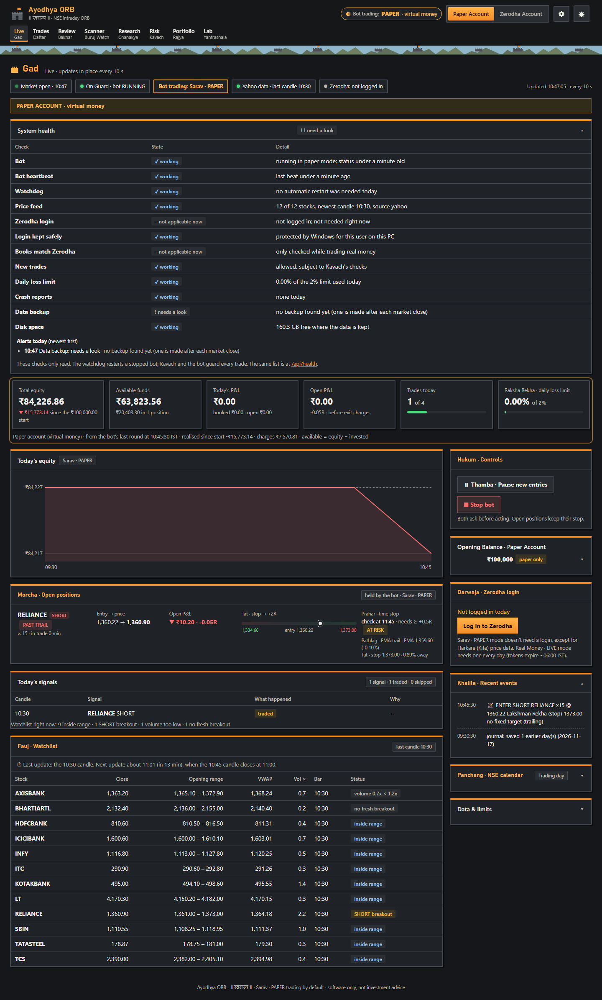

1. Look at the row of chips under the title: market open or closed, bot running or not, the trading mode,
   where prices come from and the newest finished candle, and the Zerodha login.
2. Open the **System health** card. It lists twelve checks (bot, heartbeat, watchdog, price feed, Zerodha
   login, how the login is stored, books against Zerodha, new trades, daily loss limit, crash reports, backup,
   disk). Each is *working*, *needs a look*, *NOT working* or *not applicable now*. The card stays closed
   while everything works and opens by itself when something does not.
3. A check that turns bad, or recovers, gives a popup on every page and a line under **Alerts today**.

The same list is available to other tools at `http://127.0.0.1:5000/api/health`.

### Step 5. During the day: watch, do not steer

Still on Gad:

- **Account tiles**: equity, available funds, today's result, open result, trades used today and how much of
  the daily loss limit is used.
- **Open positions**: entry, price now, result in rupees and in R (multiples of the risk taken), the stop, and
  when the one-hour time stop will check the trade.
- **Today's signals**: every signal the rules produced, whether it was traded, and if not, the exact reason
  (for example "risk budget too small for 1 share").
- **Watchlist**: each stock's opening range, VWAP, volume and status, with the time of the next update.
- **Controls**: **Pause new entries** (open positions are still managed), **Stop bot**, and, when the bot is
  not running, **Start bot**. Each asks before acting. Start tells you which mode the bot would start in; it
  cannot change the mode.

On a phone the same page stacks into one column and the page bar at the bottom scrolls sideways:

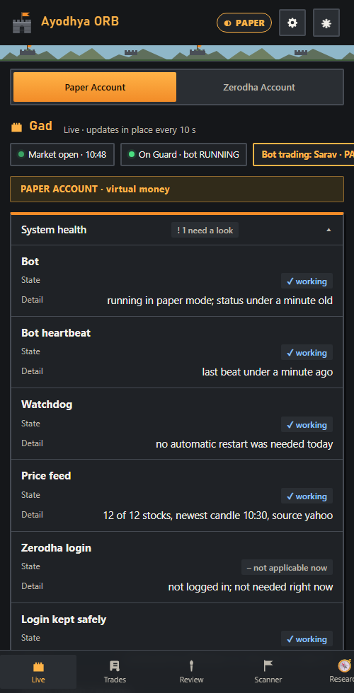

Light and dark both work with every theme (the ☀ button at the top right):

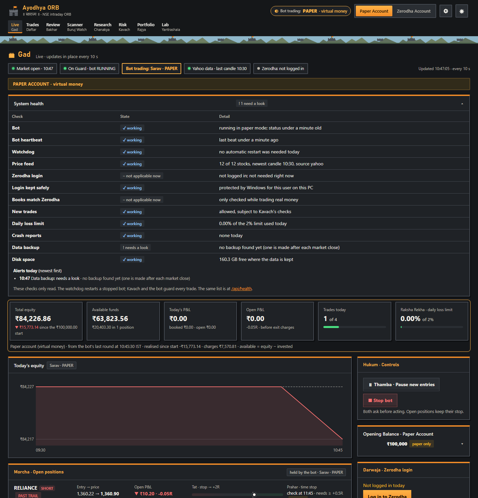

### Step 6. Why was a trade taken or refused? Kavach (Risk)

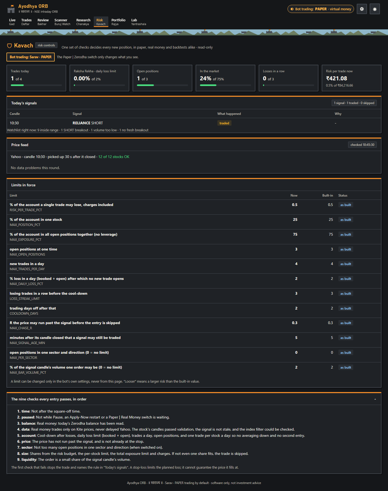

Kavach is the one set of checks that decides every new position, in paper, real money and backtests alike.
The page shows:

1. How much of today's limits is used (trades, daily loss, open positions, money in the market, losses in a row).
2. Today's signals with the check that stopped each refused one.
3. The price feed's health, and in real money the comparison with Zerodha and the order record.
4. Every limit in force next to its built-in value. A limit set *looser* than built is flagged in red.
5. The nine checks in order: time, pause, balance, data, account limits, price, sector, size, liquidity.

Nothing on this page can change a limit. Limits are changed only in the bot's own settings.

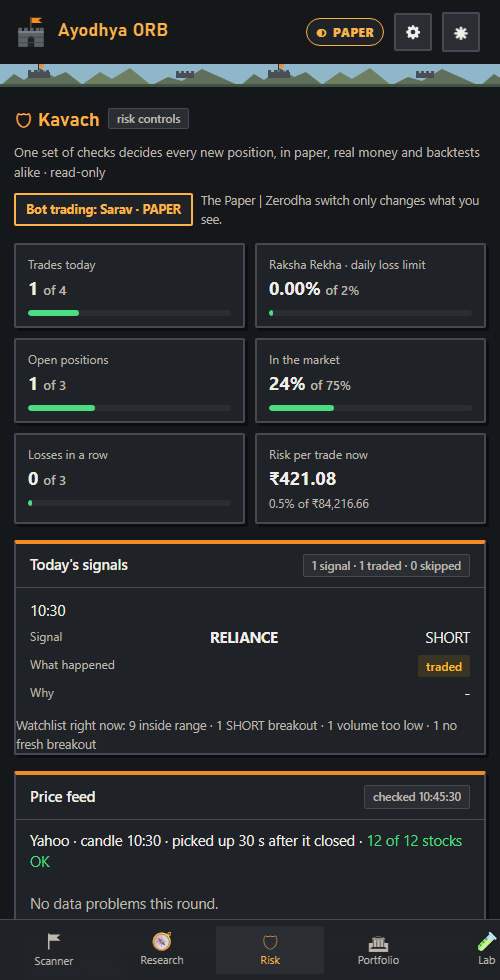

### Step 7. What speaks for and against each stock: Chanakya (Research)

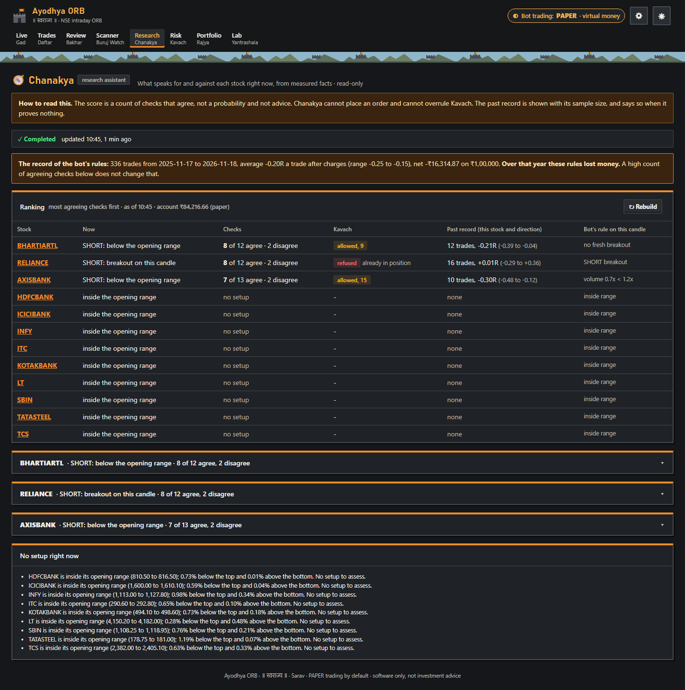

For every watchlist stock Chanakya lists measured checks (the bot's own rule, volume, VWAP, short and daily
trend, RSI, the index, the sector, room to run, stop distance, time of day, costs), the plan the bot would use
with its size and charges, Kavach's answer for your account, and how the same kind of signal did in the past.

- The score is a **count** of agreeing checks. It is not a probability.
- The past record is shown with its sample size, and says so when it proves nothing.
- Chanakya cannot place an order and cannot overrule Kavach. It uses no AI model: the same candles always give
  the same page.

### Step 8. After the close: Daftar (Trades)

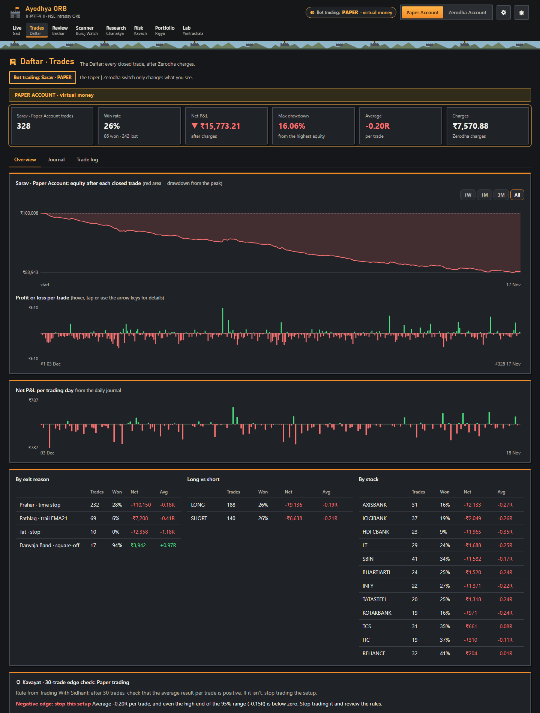

Key figures, the equity curve, results by exit reason, side and stock, the daily journal with weekly and
monthly summaries, and the full trade log. The paper and the real account each show only their own trades.

### Step 9. Replay the day and the year: Bakhar (Review)

Bakhar has two parts, chosen at the top of the page.

**One day · session review.** What the rules signalled on every stock that day and how each would have ended,
with the Time Machine.

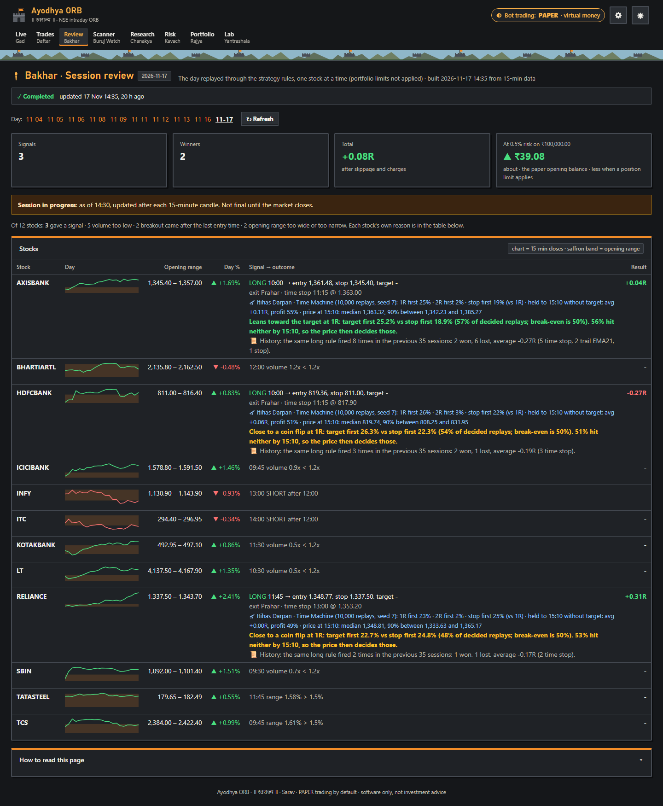

**One year · backtest.** Press **Run the backtest now**. In about ten seconds the bot's present rules run over
every day in the candle archive, with the same fills, Kavach checks and charges as the bot.

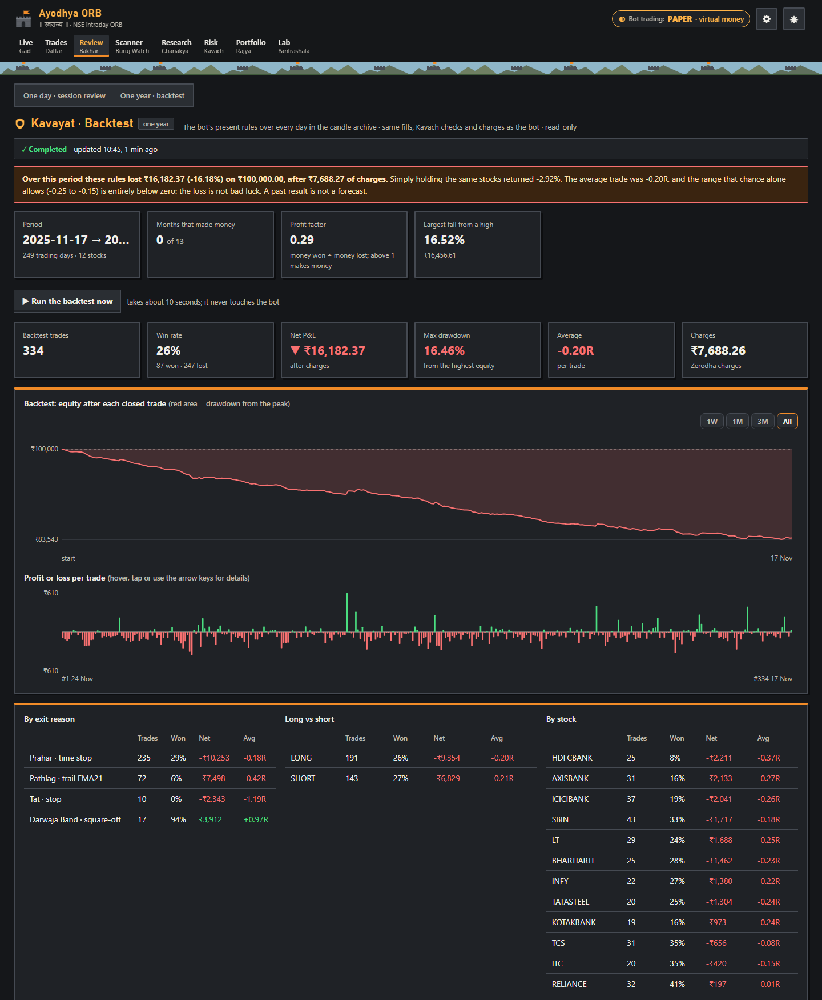

The first lines say plainly whether the rules made or lost money, what simply holding the same stocks did, and
whether the result could be luck.

### Step 10. Research only: Buruj Watch (Scanner)

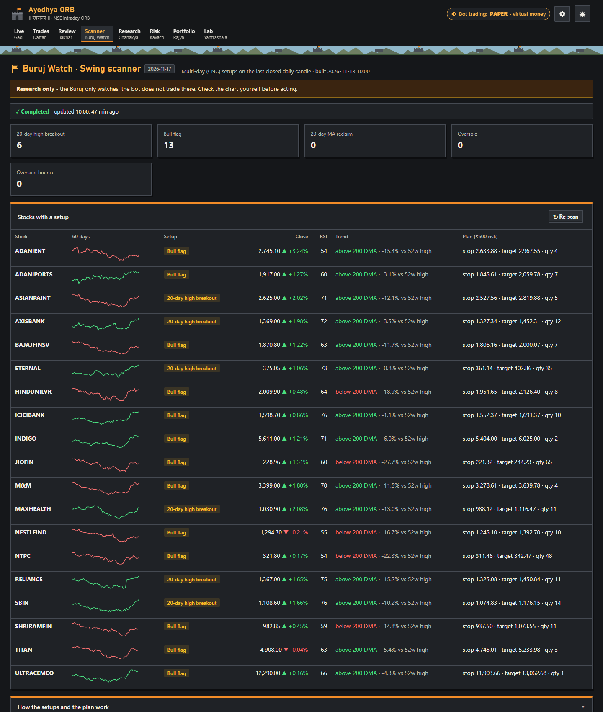

Daily-candle setups across the Nifty 50. The bot does not trade these. Builds run in the background with a
progress line and a **Cancel** button; a cancelled build saves nothing.

### Step 11. The whole account: Rajya (Portfolio)

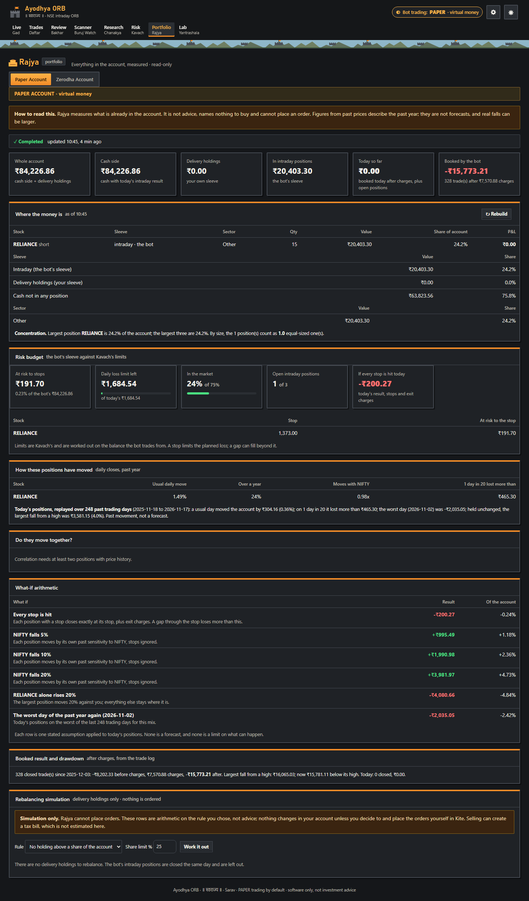

One read-only picture of cash, the bot's intraday positions and your delivery holdings: where the money is,
concentration, the risk budget against Kavach's limits, how the positions have moved over the past year, whether
they move together, what-if arithmetic, and the booked result with its drawdown.

The **rebalancing simulation** at the bottom is arithmetic on a rule you choose. Rajya cannot place orders;
nothing changes unless you place them yourself in Kite. From Zerodha it makes three read-only calls: margins,
positions and holdings.

### Step 12. Test an idea properly: Yantrashala (Lab)

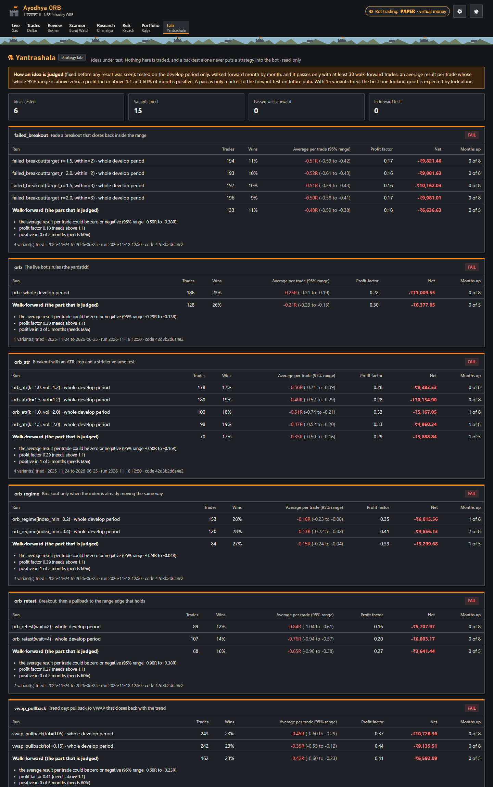

Every idea runs through the same backtest engine and is judged by a rule fixed in advance: at least 30
walk-forward trades, an average result whose whole likely range is above zero, a profit factor above 1.1 and
most months positive. An idea that passes is then registered and judged again only on data it has never seen.

```
.venv\Scripts\python.exe yantra.py list
.venv\Scripts\python.exe yantra.py test all
.venv\Scripts\python.exe yantra.py register <idea> <setting>=<value>
.venv\Scripts\python.exe yantra.py forward
```

So far six ideas have been tested (opening-range breakout, retest, failed breakout, VWAP pullback, ATR stop,
regime filter). None passed.

---

## Part 3: Is it ready? The readiness report

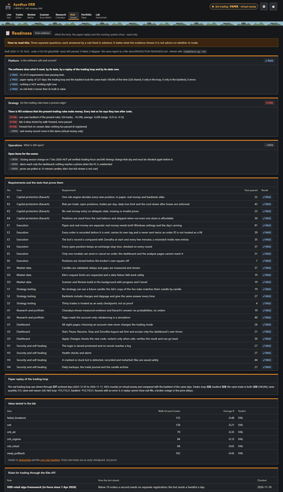

Open it from the **Data & limits** card on Gad, or at `/readiness`. It answers three separate questions by
rules fixed in advance:

| Question | Passes only when |
|---|---|
| **Platform**: is the software safe and correct? | Every requirement's tests pass, the real trading loop agrees with the backtest, nothing is broken now and no risk limit is looser than built |
| **Strategy**: do the rules have a proven edge? | A rule set passed the lab **and** then held up on unseen data. A good-looking backtest alone never counts |
| **Operations**: what is still open? | Lists what the owner still has to decide or do |

To rebuild it:

```
.venv\Scripts\python.exe paper_replay.py --out data\paper_replay.json
.venv\Scripts\python.exe readiness.py run
```

The first command drives the **real trading loop** through every archived day on virtual money (about seven
minutes) and compares it with the backtest. The second runs all tests (about five minutes) and writes
[PRODUCTION-READINESS.md](PRODUCTION-READINESS.md).

---

## Part 4: Safety and upkeep

### Secrets

Today's Zerodha login is stored protected by Windows: only your Windows user on this PC can read it. Versions
older than 2.0 cannot read that file, so after going back to an older version, log in to Zerodha again.

Your Kite API key, API secret and proxy login can be moved out of the plain Windows settings into the same
protected store. Stop the bot first:

```
.venv\Scripts\python.exe secure_secrets.py status
.venv\Scripts\python.exe secure_secrets.py move
.venv\Scripts\python.exe secure_secrets.py restore
```

`status` shows where each one is kept and never shows a value. `move` asks you to type MOVE, checks each value
reads back, and only then removes it from the Windows settings. `restore` puts everything back.

### Logs

All in `data\logs`:

| File | What is in it |
|---|---|
| `bot_<date>.log` | The bot's day in plain text |
| `events_<date>.jsonl` | The same lines of the bot and the dashboard as one JSON object per line, for searching |
| `alerts_<date>.jsonl` | Health alerts |
| `watchdog.log`, `launcher.log` | Every start, stop and automatic restart, with exit codes |
| `crash_<time>.txt` | The full error of a bot that ended with one |

API keys, the proxy login and the access token are removed before anything is written to any of them.

### Themes and settings

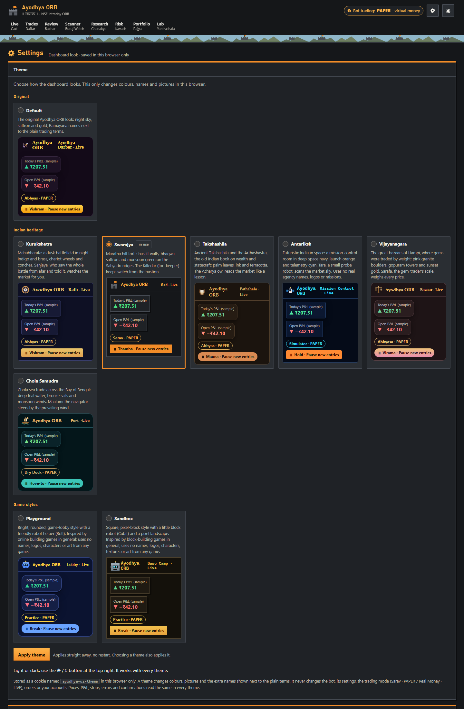

A theme changes colours, names and pictures in this browser only. It never changes the bot, its settings, the
trading mode, orders or your accounts. The Settings page also has **Apply Changes**, which checks new code
first, restarts the bot only when that is safe, verifies the result and can go back to the last good version.

### If something stops

1. The watchdog restarts a stopped bot or dashboard within five minutes in market hours (up to five times a day).
2. In real money every open position has a stop-loss order at the exchange, so a stopped bot does not leave a
   position unprotected.
3. The reason is in `data\logs`: `launcher.log` for the exit code, a `crash_<time>.txt` for an error.

---

## Part 5: What 2.0 added, in one table

| Area | New in 2.0 |
|---|---|
| Reliability | Watchdog, crash capture, hang detection, safe file saving, popups for Zerodha position changes |
| Kavach | One risk engine for paper, real money and backtests; candle validation; refusal reasons |
| Execution | Order record with unique tags, no duplicate orders, verified stop-loss, comparison with Zerodha |
| Yantrashala | Strategy lab with walk-forward testing and a forward-test register |
| Chanakya and Rajya | Research assistant and read-only portfolio view |
| Dashboard | Eight pages in the navigation, one-year backtest page, health card, Start button |
| Security | Protected login, protected secret store, logs without secrets, tests that prove who can trade |
| Readiness | Paper replay of the real trading loop and a report built from evidence |

Details are in the [CHANGELOG](../CHANGELOG.md).

## Known limits

- The trading rules have no proven edge; see Part 3.
- Alerts reach only the dashboard, not a phone.
- Prices are read as 15-minute candles; Kite's live tick stream is not used.
- The exchange's closing-session change on 7 Dec 2026 has not been checked against the bot's timings yet.
- A replay cannot show real order fills, a broker outage or live price delays.
