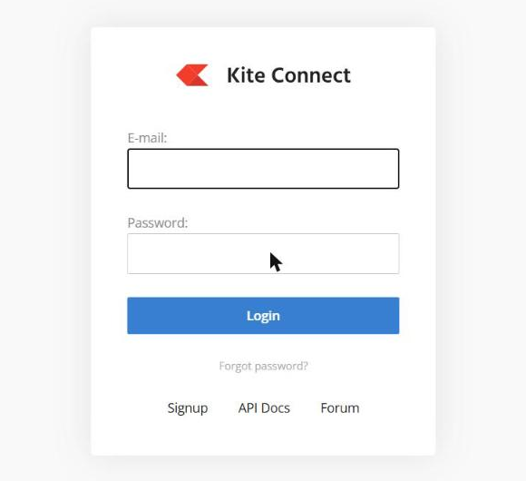
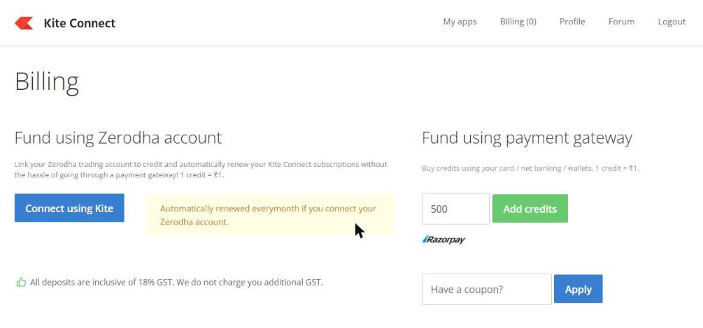
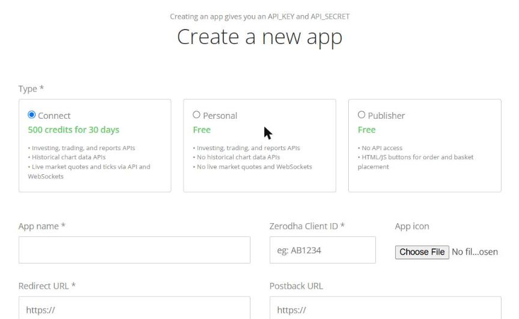

# Getting real-time data: the paid Kite Connect plan

[← back to README](../README.md)

The bot runs fine **for free** on Yahoo Finance prices. Yahoo's data can be a few minutes late and only
goes back about 60 days. For **real-time prices and years of history**, you can use Zerodha's own data,
which needs the paid **Connect** plan on your Kite developer app.

## The two Kite developer plans

| | **Personal** | **Connect** |
|---|---|---|
| Price | **Free** | **₹500 per month per app**, shown in the developer console as *"500 credits for 30 days"* (1 credit = ₹1, 18% GST already included) |
| Place orders, see holdings and positions | ✅ | ✅ |
| Historical candles (charts, backtests) | ❌ | ✅ |
| Live prices and ticks (quotes, WebSocket) | ❌ | ✅ |
| What this bot can do with it | Live trading only, prices still from Yahoo | Live trading **and** real-time Kite prices (`DATA_SOURCE = "kite"`) |

**You only need Connect if you want Zerodha's real-time data.** Paper trading needs neither plan.

Source: [Zerodha's Kite Connect FAQ](https://support.zerodha.com/category/trading-and-markets/general-kite/kite-api/articles/kite-connect-api-faqs).
Prices can change, so check the developer console before paying. Payments go to Zerodha, not to this project.

---

## Step by step

### Step 1: Sign in to the Kite developer console

Open **https://developers.kite.trade** and sign in with the email and password of your **Kite developer**
account. This is separate from your normal Kite login. If you don't have one, click **Signup**.



### Step 2: Add credits on the Billing page

1. Click **Billing** at the top of the page. The number in brackets, e.g. **Billing (0)**, is your credit balance.
2. Choose one of the two boxes:
   - **Fund using Zerodha account**: click **Connect using Kite** and approve it in Kite. The monthly fee is then
     taken from your Zerodha trading account and the plan is **renewed automatically every month**.
     You can **Unlink** it later on the same page.
   - **Fund using payment gateway**: type **500** in the box and click **Add credits**. Razorpay opens: pay
     with UPI, net banking, card or wallet. This is **manual**, so you add credits again each month.
     If you have a coupon, enter it under **Have a coupon?** and click **Apply** first.
3. For one month of Connect you need **500 credits (₹500)**. The page says *"All deposits are inclusive of
   18% GST"*, so there's nothing extra to pay. Wait until **Billing (500)** shows the new balance before going on.
4. Your payments appear under **Payment history** at the bottom, each with an **Invoice** link.



> If money left your account but the credits don't show up after a while, don't pay again. Zerodha's
> forum says to email **kiteconnect@zerodha.com** with the payment details. There is no phone support for
> Kite Connect.

### Step 3: Create the Connect app

1. Click **My apps**, then **Create a new app**.
2. Fill in the form:

| Field | What to enter |
|---|---|
| **Type** | **Connect** |
| **App name** | Any name, e.g. `ORB Bot Connect` |
| **Zerodha Client ID** | Your Zerodha user ID (top right of Kite, e.g. `AB1234`) |
| **App icon** | Optional. `assets/app-icon-64.png` is a 64×64 icon you can use |
| **Redirect URL** | `http://127.0.0.1:5000/kite/callback` (exactly this) |
| **Postback URL** | Leave empty |
| **Description** | e.g. `Personal trading bot for my own account. NSE equity intraday, paper trading first.` |

3. Click **Create**. 500 credits are taken from your balance for the first 30 days. **Payment history** shows
   it as *"Subscribe Kite Connect"*.



### Step 4: Copy the new API key and secret into the bot

The new app has a **new API key and API secret** (open the app under **My apps** to see them).
**Never share them or paste them into a file, chat, issue or screenshot.**

In a normal PowerShell window in the bot's folder, run:

```powershell
powershell -ExecutionPolicy Bypass -File .\set_kite_keys.ps1
```

Paste the new API key and secret when asked (right-click pastes; the input stays hidden). It changes only
the Kite key and secret and keeps your proxy settings. (First-time setup uses `setup_kite_proxy.ps1` instead.)

**Static IP:** SEBI requires API orders to come from a registered IP. On the developer site this is set
**once for the whole account** under **Profile → IP Whitelist** (up to 2 IPs), so it covers every app,
including a new Connect app. If your proxy IP is already listed there, there's nothing to do.

### Step 5: Check that Kite data works

1. Double-click **`3-DASHBOARD.bat`** and click **Log in to Zerodha**. Kite needs this login **every day**.
2. Double-click **`6-CHECK-KITE-DATA.bat`**. It should end with **"Kite data works"** and say how many days
   of history you get:

```
[ok] Live prices: SBIN …, NIFTY 50 …
[ok] 15-min candles: … for SBIN
[ok] History: … trading days of 15-min candles available (Yahoo gives ~60)
[ok] Kite data works.
```

If it says **"no permission … Connect plan"**, the app is still on Personal or the credits ran out. Check
Billing and My apps.

### Step 6: Switch the bot to Kite data

In PowerShell, save the setting for your Windows user (it stays after restarts):

```powershell
[Environment]::SetEnvironmentVariable("DATA_SOURCE", "kite", "User")
```

Restart the bot. The **Live** page now shows **Price data: Kite (real-time)**. To go back to Yahoo, run the
same line with `"yahoo"`. (You can also change the default in `config.py` instead.)

---

## Every month

- The Connect plan runs for **30 days**. With a **linked Kite account** it renews automatically; with
  **online payment** you add 500 credits again before it ends.
- If it runs out, Kite data stops working, and the bot **automatically switches back to Yahoo**. The Live page
  shows *"Price data: Yahoo"* with the reason, and trading carries on.
- To stop paying: **My apps** → your app → **Cancel**. The app's settings are kept and you can reactivate it.
  To stop automatic payment: **Billing** → **Unlink**.

## Questions

**Do I need Connect for paper trading?** No. Paper trading uses free Yahoo data.

**Do I need Connect for live trading?** No. The free Personal plan can place orders. Connect only adds
Zerodha's real-time prices, which make live trading more accurate.

**Is it worth ₹500 a month?** It gives prices without delay and enough history to test the strategy on data
it wasn't tuned on. Remember that the strategy **lost money in testing** either way.
